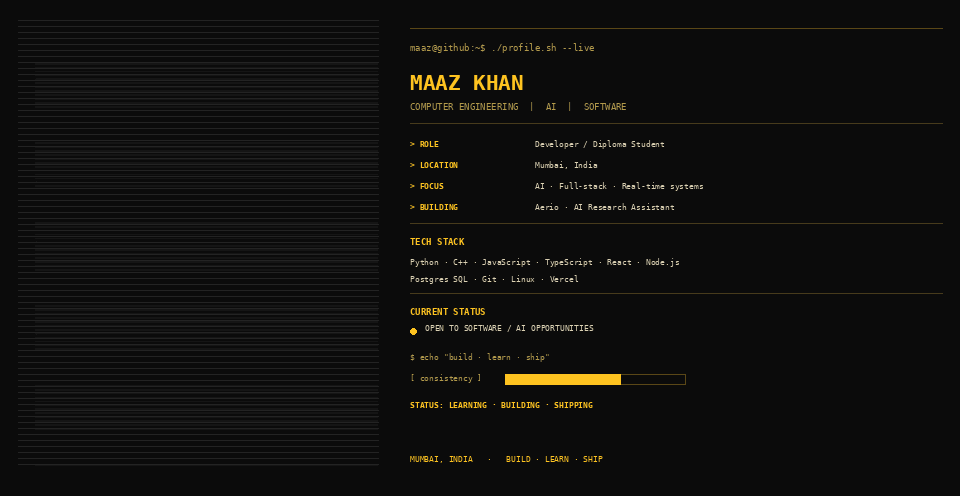

  

# MAAZ KHAN

**Computer Engineering Student · AI & Software Developer**

Building practical AI tools, full-stack applications, and systems that solve real problems.

 

---

## About

I'm a Diploma in Computer Engineering student from Mumbai, India, building practical software across **AI applications, full-stack systems, real-time products, and automation**.

- Designing and building end-to-end products—from UI and APIs to databases, deployment, and debugging
- Exploring AI engineering: structured generation, provider integrations, local models, and human-in-the-loop workflows
- Interested in privacy-aware systems, useful automation, and software that solves real operational problems
- Learning by shipping projects, testing assumptions, and improving the architecture as requirements become clearer

**My approach:** Understand the problem → design the system → build → test → improve.

---

## Current Focus

| Area | Current work |
|---|---|
| **AI engineering** | LLM application architecture, structured outputs, provider abstraction, local-model experiments |
| **Full-stack development** | Next.js, React, TypeScript, Node.js, FastAPI |
| **Backend & data** | REST APIs, PostgreSQL, SQLAlchemy, Supabase, authentication, tenant-aware data |
| **Real-time systems** | Socket.IO, messaging workflows, event-driven communication |
| **Deployment & tooling** | Git/GitHub, Docker, Vercel, Render, Linux |
| **Core programming** | C++, Python, JavaScript, TypeScript, Java fundamentals |

---

## Selected Projects

### 1. AI Hospital Discharge Summary Generator
A multi-hospital SaaS concept for preparing structured discharge-summary drafts from patient encounter documents, optional audio, and clinician notes.

- **Frontend:** Next.js, React, TypeScript
- **Backend:** FastAPI, SQLAlchemy, PostgreSQL
- Encounter-centered workflow with document uploads, optional audio and notes
- Provider-agnostic AI foundation being designed for structured draft generation
- Intended safeguards include tenant isolation, source traceability, and clinician review before final PDF approval

**Status:** In active development. AI provider integration, extraction/transcription, and final PDF workflow are planned; not yet a production clinical system.

### 2. [Aerio — Real-Time Messaging](https://github.com/maazcrafts/Aerio)
A full-stack messaging application focused on real-time communication and private conversations.

- Real-time messaging with **Socket.IO**
- Node.js backend and PostgreSQL
- React Native mobile experience
- Exploring end-to-end encryption using NaCl public-key cryptography
- Email verification, voice notes, GIFs, and attachments

[Open live app](https://aerio-delta.vercel.app/chat)

### 3. LocalMind — Local AI Desktop Assistant
An in-progress personal assistant project exploring local AI and desktop workflows.

- Experimenting with local model integration through **Ollama**
- Exploring natural-language interaction with useful PC workflows
- Priorities: local-first operation, practical tool execution, and clear permission boundaries

**Status:** Early development / architecture and MVP work.

### 4. [AI Phone Receptionist](https://github.com/maazcrafts/AI-Phone-Receptionist)
An AI receptionist concept designed to answer calls and collect caller details conversationally, with Hinglish interaction and local-model experimentation.

### 5. QuickStitch / QuickInfo
A product and UI engineering project focused on translating a defined interface into a responsive, functional web experience.

- Next.js, TypeScript, Tailwind CSS
- Component-based frontend implementation
- Responsive layouts and functional interactions
- Focus on preserving the supplied design as the source of truth

**Status:** In development.

### 6. Finora — Personal Finance App
A finance-tracking project exploring transaction management, summaries, visual analytics, voice-based transaction entry, and AI assistance.

### 7. [Alfiya Mehendi](https://github.com/maazcrafts/Alfiya-Mehendi)
A booking and commerce website for mehendi services and related products.

- Booking requests with date/time selection and admin approval
- Booking history and cancellation flow
- Supabase-backed data and authentication
- Service and product-oriented business workflow

[Open live website](https://alfiya-mehendi-nine.vercel.app)

### 8. Machine Learning Projects
Introductory prediction applications using **Logistic Regression**, including diabetes prediction and credit-risk prediction, with model evaluation and interactive Streamlit interfaces.

---

## Tech Stack

---

## GitHub Overview

 

---

## Connect

- **Portfolio:** https://maaz-portfolio-orpin.vercel.app/
- **LinkedIn:** https://linkedin.com/in/khan-maaz-8a3345377
- **Email:** maazsabirkhan@gmail.com

**LEARN DEEPLY · BUILD USEFUL THINGS · KEEP ITERATING**

